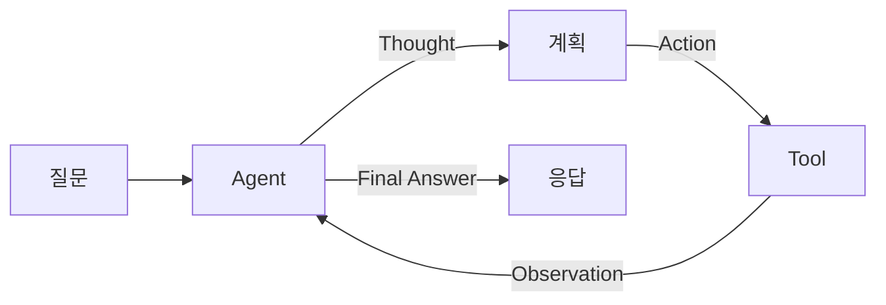
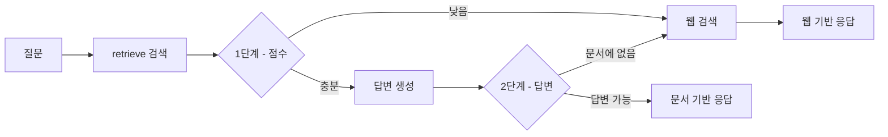

# ch01/dxx-app — Gemini API 기반 RAG/Agent 단계별 학습 예제

문서 로딩부터 브라우저 GUI 까지, RAG 파이프라인을 8단계로 분해한 교육용 코드베이스.

## 설계 원칙

이 코드베이스는 아래 세 가지를 지키도록 만든다. 변경할 때도 이 조건을 깨지 않아야 한다.

**1. 한 파일 = 한 단계.** 파일 하나가 파이프라인의 한 단계에 1:1 대응한다.
단계마다 새 개념을 정확히 하나씩 더한다.
`0-env.py` 는 설정 로딩이라 지식 처리 단계(1번부터)보다 앞선 0번을 쓴다.

**2. 점층 구성.** 뒤 단계는 앞 단계를 모듈로 재사용하고, 같은 것을 다시 만들지 않는다.
의존은 항상 낮은 번호 쪽으로만 향한다. 역참조가 생기면 단계 구분이 무너진 것이다.

**3. 각 파일은 단독으로 실행되어 그 단계를 보여준다.**
`python <파일>` 로 실행하면 그 단계가 무엇을 하는지 출력으로 드러나야 한다.
뒤 단계를 실행해야만 확인되는 기능은 학습 자료로 성립하지 않는다.

세 번째 조건의 현재 상태다. 파일을 고칠 때마다 이 표가 유지되는지 확인한다.

`GEMINI_API_KEY` 없이 실행했을 때의 결과를 세 등급으로 나눴다.

| 등급 | 뜻 |
|---|---|
| **전부** | 끝까지 실행된다. 종료 코드 0 |
| **일부** | API 호출 직전까지 출력한 뒤 안내 메시지와 함께 종료한다. 종료 코드 1 |
| **기동** | 서버나 프롬프트는 뜬다. 키가 필요한 요청을 보낼 때만 실패한다 |

| 파일 | 키 없이 | 어디까지 / 무엇을 보여주나 |
|---|---|---|
| `0-env.py` | **전부** | `.env` 에서 올라간 환경 변수 키 목록 (값은 미출력) |
| `1-documents.py` | **전부** | JSON → `Document` 변환 결과 12건 |
| `2-embeddings.py` | 일부 | 샘플 문서까지. 임베딩 직전에 멈춘다 |
| `3-llm.py` | 일부 | 질문만 출력하고 멈춘다 |
| `4-1-rag.py` | 일부 | **문서 12건 로드까지.** 임베딩 직전에 멈춘다 |
| `4-2-websearch.py` | 일부 | `[W1] 그라운딩 요청` 까지. 호출 직전에 멈춘다 |
| `5-agent.py` | 일부 | **문서 목록·구성 요약 2문항까지.** 세 번째 질문에서 멈춘다 |
| `6-api.py` | 기동 | `/health` `/documents` `/tools` 는 정상. `/rag` `/agent` 만 500 |
| `7-chatbot.py` | 기동 | 프롬프트와 슬래시 명령은 정상. 질문을 던지면 안내 메시지 |
| `8-gui.py` | 기동 | 화면과 `/health`(`api_key:"없음"`)는 정상. 대화만 실패 |

**"일부"가 결함은 아니다.** 임베딩과 생성이 그 단계의 본질이므로 키 없이 끝까지 갈 수 없는
것이 정상이다. 중요한 것은 **어디서 멈추는지가 출력에 드러나는가**이다.
`4-1-rag.py` 는 문서 12건을 모두 보여준 뒤 멈추므로, 키가 없어도 1단계의 결과가
4-1단계로 어떻게 넘어오는지는 확인할 수 있다.

`0-env.py` 와 `1-documents.py` 는 키 없이 전 과정을 볼 수 있어, **키 발급 전에 먼저
읽을 수 있는 진입점**이다. 이 둘로 파이프라인의 입구를 이해한 뒤 키를 발급받는 순서가 된다.

**원칙 2와 3이 충돌할 때는 3이 우선한다.** 파일이 혼자 돌아가려면 앞 단계에서 만든 헬퍼를
자기도 하나 가져야 하는 경우가 있다. 이때는 중복을 허용하되, **합성 경로에서는 반드시
앞 단계 것 하나만 쓰이도록** 만든다.

현재 해당하는 것은 `require_gemini()` 하나다.

| 정의 위치 | 호출 시점 | 성격 |
|---|---|---|
| `2-embeddings.py` | `main()` 에서만 | 단독 실행 전용 |
| `3-llm.py` | `generate_direct_answer()`, 4-1, 4-2 | **합성 경로의 공용 진입점** |

합성 경로에서 2단계 것이 쓰이지 않는 이유는 `embed_text(genai, text)` 가 genai 를
인자로 받기 때문이다. 호출자가 3 에서 얻은 genai 를 그대로 넘긴다. 이 형태를 유지하면
헬퍼가 중복되어도 실제 실행 경로는 하나로 유지된다.

## 데이터 흐름

RAG 본체 (4-1):

```
Document → Embed → Vector DB → search → Prompt → LLM → 답변
   (1)      (2)       (4-1)      (4-1)    (4-1)   (3)
```

번호는 층위를 나타낸다. **1·2·3 은 기반**이고 앞 단계를 참조하지 않는다.
**4-1·4-2 는 그 기반을 조합한 두 개의 지식 소스**이며, 둘 다 (3) 의 `generate_answer()` 를 재사용한다.

```
  [기반]  (1) 문서    (2) 임베딩    (3) LLM 호출
                                      ↑        ↑
  [조합]  (4-1) 로컬 문서 검색 ────────┘        │
              1-documents.json — 직접 관리하는 고정 코퍼스
          (4-2) 웹 검색 ──────────────────────┘
              외부 검색 결과 — 모델이 검색과 생성을 함께 수행
```

지식 소스가 셋이라고 볼 수도 있다. (3) 을 단독 실행하면 검색 없이 모델 내부 지식만으로
답하기 때문이다(`generate_direct_answer()`). 다만 (3) 은 그 자체로 하나의 소스이면서
동시에 4-1·4-2 가 의존하는 공용 모듈이라, 번호상 같은 층위에 두지 않았다.

라우팅과 표면:

```
              (5) Agent — 문서 우선, 실패 시 웹
                          ↑
        ┌─────────────────┴─────────────────┐
  (6) FastAPI HTTP          (7) CLI 챗봇 (대화 이력)
                                      ↑
                            (8) 브라우저 GUI (7단계 재사용)
```

1~6단계는 질문 1개당 답변 1개로 매번 독립적이다. 7단계에서 처음으로 대화 이력이 도입되어
후속 질문("그럼 주말은?")이 앞 턴에 기대어 해석된다.
8단계는 새 로직을 추가하지 않는다. 7단계의 `ChatSession` 과 `answer()` 를 그대로 호출하고
입출력 표면만 터미널에서 브라우저로 바꾼다.

## 구성

```
ch01/dxx-app/
├── 1-documents.py     Document 데이터클래스 + 1-documents.json 로더
├── 2-embeddings.py    Gemini 임베딩 (문서용 / 질의용 task_type 분리)
├── 3-llm.py         Gemini 생성 호출 전담 (RAG 답변 / 일반 답변)
├── 4-1-rag.py         인메모리 벡터DB, 코사인 유사도 검색, 프롬프트 조립
├── 4-2-websearch.py   외부 웹 검색 (Gemini 그라운딩)
├── 5-agent.py         규칙 기반 도구 선택 에이전트 (5개 도구)
├── 6-api.py           FastAPI 래퍼 (/health /documents /tools /rag /agent)
├── 7-chatbot.py       CLI 대화형 챗봇 (멀티턴 이력, 슬래시 명령)
├── 8-gui.py           브라우저 GUI (FastAPI + 정적 HTML, 7단계 래핑)
├── demo.md            실행 매뉴얼 (명령·기대 출력·문제 해결)
├── 0-env.py           .env 로더 (0단계 — 다른 단계보다 먼저 실행)
├── requirements.txt   서드파티 패키지 4종 (버전 고정)
├── .env.sample        환경 변수 견본 (.env 로 복사해 사용)
├── 1-documents.json   샘플 코퍼스 12건 (고객 지원 FAQ 도메인)
└── readme.md
```

### 단계별 역할

| 파일 | 핵심 구현 | 외부 의존 |
|---|---|---|
| `1-documents.py` | `Document(doc_id, text)`, `load_documents()` | 없음 |
| `2-embeddings.py` | `embed_text()` / `embed_query()`, 기본 모델 `models/gemini-embedding-001` | `google-generativeai`, `GEMINI_API_KEY` |
| `3-llm.py` | `generate_answer()` / `generate_direct_answer()`, 기본 모델 `gemini-2.5-flash`, temperature 0.2 | 동일 |
| `4-1-rag.py` | `InMemoryVectorDB`, `cosine_similarity()`, `build_prompt()`, `run_rag()` | 1·2·3 |
| `4-2-websearch.py` | `run_websearch()` — REST 로 `google_search` 도구 호출, 그라운딩 메타데이터에서 검색어·출처 추출 | 3 |
| `5-agent.py` | `choose_action()` 은 `tool_list_documents` / `tool_document_summary` / `tool_rag` 중에서만 고른다. `tool_web_search` 는 `tool_rag` 의 폴백으로, `tool_direct_answer` 는 `/mode direct` 로만 호출된다 | 1·2·3·4-1·4-2 |
| `6-api.py` | 위 기능의 HTTP 노출, `translate_error()` 로 `SystemExit` → 500 변환 | `fastapi`, `uvicorn`, `pydantic` |
| `7-chatbot.py` | `ChatSession` 이력 관리, `is_followup()` 후속 질문 판정, 검색용/생성용 질의 분리 | 4 (경유해 1·2·3·4-1·4-2) |
| `8-gui.py` | 세션별 `ChatSession` 보관, `redirect_stdout` 으로 판단 과정 캡처, 단일 HTML 서빙 | 6 (경유해 전 단계), `fastapi`, `uvicorn` |

### 모듈 로딩 방식

파일명이 숫자로 시작해 일반 `import` 가 불가능하므로, 각 파일은 `importlib.util.spec_from_file_location()`
으로 경로를 직접 지정해 로드하고 `sys.modules` 에 논리 이름(`documents`, `embeddings`, `llm`)으로 등록한다.
학습 목적의 우회이며, 프로덕션 패키지 구조에는 적합하지 않다.

## 실행

단계별 명령, 기대 출력, 문제 해결 표는 [demo.md](demo.md) 에 정리되어 있다.

```bash
source venv/bin/activate && cd ch01/dxx-app     # 가상환경 활성화
cp .env.sample .env                             # 최초 1회, GEMINI_API_KEY 를 채운다

python 0-env.py           # .env 가 읽히는지 확인
python 1-documents.py     # JSON → Document 변환 확인
python 2-embeddings.py    # 임베딩 차원/프리뷰 확인
python 3-llm.py           # LLM 단독 호출
python 4-1-rag.py         # 검색 → 프롬프트 → 답변 (예제 질문 3개)
python 4-2-websearch.py   # 웹 검색 → 답변 + 근거 출처
python 5-agent.py         # 도구 선택 트레이스 포함 실행
python 6-api.py           # http://127.0.0.1:8000/docs
python 7-chatbot.py       # 대화형 챗봇 (/help 로 명령 목록)
python 8-gui.py           # http://127.0.0.1:8001  브라우저 GUI
```

### 환경 변수

| 이름 | 기본값 | 용도 |
|---|---|---|
| `GEMINI_API_KEY` | 없음 (필수) | 2·3·4-1·4-2 단계의 API 호출 |
| `GEMINI_MODEL` | `gemini-2.5-flash` | 답변 생성 모델 |
| `GEMINI_EMBED_MODEL` | `models/gemini-embedding-001` | 임베딩 모델 |
| `RAG_MIN_SCORE` | `0.65` | 5단계 1단계 판정 임계값 |

값은 같은 폴더의 `.env` 에 넣는다. [0-env.py](0-env.py) 가 각 단계 시작 시 자동으로 읽으므로
`source` 할 필요가 없다. **셸에 이미 있는 값이 우선하므로** 일회성 지정도 그대로 통한다.

```bash
RAG_MIN_SCORE=0.5 python 5-agent.py   # 이번 실행만 임계값 0.5
```

## 단계별 상세

### 4-2단계 웹 검색

```bash
python 4-2-websearch.py     # GEMINI_API_KEY 필요
```

세 번째 지식 소스다. 3 은 모델 내부 지식, 4-1 는 로컬 문서, 4-2 은 외부 웹을 쓴다.
**4-1 와의 차이는 결과의 출처와 형식이다.** `1-documents.json` 은 직접 작성한 12건이라 길이와
형식이 일정하지만, 웹 결과는 길이·문자 구성·URL 형식이 제각각이라 그대로 프롬프트에 넣을 수 없다.
따라서 이 단계의 학습 내용은 검색 자체가 아니라 외부 텍스트를 프롬프트에 넣기 전에 다듬는 방법이다.

**Gemini 내장 검색(그라운딩)을 쓴다.** 별도 검색 서비스 키가 필요 없고,
`GEMINI_API_KEY` 하나로 동작한다.

```
4-1  : 검색 결과를 받아 → 프롬프트 조립 → LLM 호출     (단계가 나뉨)
4-2  : 모델이 내부에서 검색과 답변 생성을 한 번에 수행   (한 호출)
```

중간 산출물(검색 결과 목록)이 없다. 대신 응답의 그라운딩 메타데이터에서
**모델이 실제로 실행한 검색어**와 **근거 출처 URL** 을 꺼내 `[W1]~[W4]` 로 출력한다.
출처 URL 은 대부분 `vertexaisearch.cloud.google.com` 리다이렉트 형태로 온다.

`safe_url()` 로 스킴을 확인하고 `clean()` 으로 제목의 제어문자를 걷어내는 정도만 손댄다.
답변 문자열 자체는 모델이 만든 것을 그대로 쓴다.

**SDK 대신 REST 를 직접 호출한다.** `google-generativeai` 0.8.6 이 `google_search`
도구를 요청에 싣지 못하기 때문이다. `urllib` 만 쓰므로 새 의존성은 없다.

### 5단계 에이전트

에이전트는 보통 **관찰 결과를 다시 계획에 반영하는 순환**이다. 도구를 쓰고, 결과를 보고,
충분하지 않으면 다시 계획해 또 도구를 쓴다. 충분해졌다고 판단하면 최종 답변을 낸다.



**이 예제는 그 순환을 구현하지 않는다.** 한 번 계획하고, 한 번 실행하고, 끝낸다.


`run_agent_with_trace()` 는 `[계획] → [행동] → [관찰]` 을 차례로 출력하지만,
`[관찰]` 뒤에 곧바로 반환한다. 관찰 결과가 계획으로 되돌아가는 화살표가 없다.
위 두 그림의 차이가 그 화살표 하나다.

순환이 아예 없는 것은 아니다. `tool_rag()` 안에 **결과를 보고 경로를 바꾸는 판단**이 있다.
검색 점수를 관찰해 1단계에서 갈리고, 생성된 답변을 관찰해 2단계에서 갈린다.



순환의 축소판이다. 다만 그 판단이 **에이전트가 아니라 도구 안에 있고, 한 번만 일어난다.**
진짜 에이전트라면 웹 검색 결과를 다시 관찰해 "이것으로 충분한가"를 판단하고,
부족하면 또 다른 도구를 고를 것이다. 이 예제는 거기까지 가지 않는다.

**라우팅** — [5-agent.py](5-agent.py) 의 `choose_action()` 은 세 갈래뿐이다.
**웹 검색은 최후 수단이며, 라우팅 단계에서는 선택되지 않는다.**

```
1. 몇 개 · 구성 · 종류 · 요약   →  tool_document_summary
2. 문서 · 목록 · documents     →  tool_list_documents
3. 그 외 전부                  →  tool_rag
```

문서 주제인지 미리 가르지 않는다. 판단은 `tool_rag` 안에서 실제 검색·생성 결과를 보고 한다.

**2단 판정** — `tool_rag` 는 두 번 판단한 뒤에야 웹으로 넘긴다.

```
질문 → retrieve()
  ├ 1단계  점수 < RAG_MIN_SCORE  → 관련 문서 없음. 생성 없이 웹으로
  └ 1단계  점수 >= RAG_MIN_SCORE → answer_with_contexts() 로 답변 생성
       ├ 2단계  "문서에 없습니다" → 문서로 답하지 못함. 웹으로
       └ 2단계  그 외             → 문서로 답변 완료
```

1단계는 관련 없는 질문에서 생성 호출을 아끼고, 2단계는 유사도로 갈리지 않는 경우를 잡는다.
[4-1-rag.py](4-1-rag.py) 의 검색과 생성을 `retrieve()` / `answer_with_contexts()` 로
분리해 둔 것이 1단계를 가능하게 한다.

**왜 2단계가 필요한가** — 최신성은 유사도로 표현되지 않는다. 실측값이다.

| 질문 | 최고 유사도 | 문서로 답할 수 있는가 |
|---|---|---|
| 지금 고객센터 열려 있어? | 0.7572 (policy) | 부분적으로 가능 (운영 시간은 있음) |
| 오늘 서울 날씨 어때? | 0.7222 (weather) | 불가능 |
| 환불 규정 알려줘 | 0.7480 (refund) | 가능 |

세 질문의 점수 구간이 겹쳐 하나의 임계값으로는 가를 수 없다. 실제로 답을 만들어 봐야 안다.

이전에는 시점 표지(`오늘`·`지금`·`최근`…)가 있으면 검색 없이 바로 웹으로 보냈다.
그 방식은 `"지금 고객센터 열려 있어?"` 처럼 문서가 답할 수 있는 질문까지 웹으로 넘겼다.
그전에는 코퍼스 키워드 목록으로 갈랐고, 문서를 추가할 때마다 목록을 고쳐야 했다.
지금은 두 목록 모두 없다.

**2단계 판정 기준** — 프롬프트가 지시한 `문서에 없습니다` 계열만 표지로 쓰고,
답변이 60자를 넘으면 유용한 정보가 함께 담긴 것으로 보아 실패로 처리하지 않는다.

```
"문서에 없습니다."                                      9자  → 웹으로
"문서에 없습니다. 고객 지원 시간은 평일 09:00–18:00 …"   84자  → 문서로 답변
```

표지를 넓게 잡으면 오탐이 난다. `알 수 없습니다` 를 표지에 넣었더니 운영 시간을 정확히
전달하는 답변이 버려지고 웹 검색으로 넘어갔다.

### 폴백 설계의 한계

이 구조를 택하면서 감수한 것들이다. 고칠 수 있는 것과 구조상 못 고치는 것이 섞여 있다.

**시도해 보기 전에는 실패할지 알 수 없다** — 폴백의 본질적 한계다. 미리 알 수 있다면
폴백이 아니라 라우팅으로 충분하다. 모르니까 시도하고, 시도한 것이 버려진다.
`"오늘 서울 날씨 어때?"` 는 `weather` 문서와 0.7222 로 가까워 1단계를 통과하지만
오늘 날씨는 문서에 없다. 답변을 만들어 본 뒤에야 알 수 있고, 그 답변은 버려진다.

실측한 호출 횟수다. 세 경우 모두 임베딩은 13회씩 나간다.

| 질문 | 경로 | 문서 생성 | 웹 생성 |
|---|---|---|---|
| 환불 규정 알려줘 | 1·2단계 통과 | 1 | 0 |
| 오늘 서울 날씨 어때? | 2단계에서 전환 | 1 | **1** (문서 답변은 버려짐) |
| 파이썬은 어떤 언어야? | 1단계에서 차단 | 0 | 1 |

| 질문 | 경로 | 문서 생성 | 웹 생성 |
|---|---|---|---|
| 환불 규정 알려줘 | 문서로 답변 | 1 | 0 |
| 오늘 서울 날씨 어때? | 2단계 전환 | 1 | **1** (문서 답변은 버려짐) |
| 카드 게임 추천해줘 | 1단계 차단 | 0 | 1 |

**임계값은 정확도가 아니라 비용을 조절한다** — 오류 방향이 비대칭이기 때문이다.
기준이 낮으면 답변을 만들어 보고 2단계가 걸러내므로 생성 1회 낭비로 끝나지만,
기준이 높으면 답변을 만들어 보지 않아 2단계가 개입할 수 없다. 문서로 답할 수 있었던
질문이 조용히 웹으로 새고 로그에도 "점수 미달"로만 남는다. 그래서 낮은 쪽으로 잡았다.
0.65 는 잠정값이며 표본이 작다. 코퍼스나 임베딩 모델을 바꾸면 다시 재야 한다.

**2단계 판정이 모델 출력 표현에 의존한다** — `is_insufficient()` 는 `문서에 없습니다`
표지와 답변 길이(60자)로 판단한다. 표현이 달라지면 놓치고, 60자 경계도 임의값이다.
`generate_answer()` 의 temperature 를 0 으로 낮춰 변동 폭은 줄였으나 없앤 것은 아니다.
정공법은 프롬프트가 `[FOUND]`/`[NOT_FOUND]` 같은 표식을 첫 줄에 쓰게 하고 그것만 보는
것이다. 학습용으로는 지금 방식의 취약함을 드러내 두는 편이 낫다고 보아 적용하지 않았다.

**코퍼스 구성이 폴백 빈도를 좌우한다** — `weather` 문서가 대표적인 예다. "서울의 여름
날씨는 대체로 덥고 습하다"는 고정 문서인데, 날씨 질문은 대개 최신성을 요구한다.
유사도는 높게 나오고 답은 못 하니 2단계까지 가는 전형적인 경우가 된다.
시의성 있는 주제를 고정 코퍼스에 넣으면 이런 낭비가 구조적으로 생긴다.

**줄이려면 임베딩부터** — 생성 1회보다 문서 13건 재임베딩이 실제로 더 큰 비용이다.
`InMemoryVectorDB` 가 프로세스 메모리라 질문마다 전체를 다시 임베딩한다.
인덱스를 영속화하면 대부분 사라지며, 2회 생성보다 이쪽이 효과가 크다.

`tool_direct_answer` 는 `choose_action()` 이 선택하지 않는다. 7단계에서
`/mode direct` 로 명시했을 때만 쓰인다. 검색이 불필요한 일반 상식 질문에 쓴다.

2단 판정은 에이전트가 도구를 고른 경우에만 적용된다. 사용자가 경로를 명시한 호출
(7단계 `/mode rag`, 6단계 `POST /rag`)은 `run_rag()` 를 직접 호출하므로 폴백 없이
로컬 문서로만 답한다. 명시적 지시를 임의로 뒤집지 않기 위한 구분이다.

### 7단계 챗봇 명령

| 명령 | 동작 |
|---|---|
| `/mode agent\|rag\|direct` | 답변 경로 전환. 기본값 `agent` (5단계 도구 선택 사용) |
| `/topk <1-10>` | RAG 검색 문서 수 |
| `/docs` | 현재 코퍼스 출력 |
| `/history` / `/reset` | 대화 이력 확인 / 초기화 |
| `/quit` | 종료 (Ctrl-D 동일) |

대화 이력은 최근 `MAX_HISTORY_TURNS`(8턴)만 유지한다. 후속 질문으로 판정되면
**검색용 질의**(직전 질문 1개만 붙임)와 **생성용 프롬프트**(이력 블록 전체)를 분리해 만든다.
이력 전체를 임베딩에 넣으면 검색 벡터가 흐려지기 때문이다.

도구 라우팅은 사용자가 실제로 입력한 원문으로만 수행한다. 맥락이 합쳐진 질의로 라우팅하면
직전 질문의 키워드가 분기 판단을 흐린다(예: `"문서 구성 요약해줘"` + `"서울 여름 날씨 어때?"`
→ `요약` 에 걸려 RAG 대신 문서 요약 도구가 선택됨).


실행 전 리포지터리 루트의 가상환경을 활성화한다.

```bash
source venv/bin/activate && cd ch01/dxx-app
```

### 8단계 GUI

```bash
python 8-gui.py     # http://127.0.0.1:8001
```

새 패키지를 설치하지 않는다. 이미 있는 `fastapi`/`uvicorn` 으로 정적 HTML 한 장을 서빙한다.
Streamlit/Gradio 를 쓰지 않은 이유는 두 가지다. 자체 런타임을 들고 오기 때문에 5·7단계에서
만든 자산을 우회하게 되고, 검증 대상 의존성이 늘어난다.

| 엔드포인트 | 용도 |
|---|---|
| `GET /` | 화면(단일 HTML). 외부 CDN 참조 없음 |
| `POST /api/chat` | 7단계 `answer()` 호출. 답변 + 판단 과정 트레이스 반환 |
| `POST /api/settings` | 세션의 `mode` / `top_k` 변경 |
| `POST /api/reset` | 대화 이력 초기화 |
| `GET /api/modes` | 모드 목록 및 문서 수 |
| `GET /health` | 생존 확인, 세션 수, **키 보유 여부·pid·기동 시각** |

CLI의 슬래시 명령은 화면 상단 컨트롤로 대응된다. `/docs` 만 대응 요소가 없다.

**판단 과정 표시** — 7단계 `answer()` 는 도구 선택 근거를 `stdout` 으로 출력한다.
GUI 는 `contextlib.redirect_stdout` 으로 이를 가로채 '실행 추적' 패널에 보여준다.
`redirect_stdout` 은 프로세스 전역이므로 동시 요청이 서로의 출력을 섞는다.
`threading.Lock` 으로 직렬화했고, 그 대가로 요청이 순차 처리된다.

**구현 세부** — 6단계에 없던 처리를 여기서 추가했다.

| 처리 | 이유 |
|---|---|
| 답변을 `textContent` 로 삽입 (`innerHTML` 미사용) | 문서·LLM 출력에 포함된 마크업이 해석되지 않고 글자 그대로 보인다 |
| `session_id` 는 서버가 `secrets.token_urlsafe` 로 발급 | 세션 ID 충돌을 피한다 |
| `message` 길이 2000자 상한 | 과도한 토큰 소비를 막는다 |
| 예외 메시지는 `detail` 대신 stderr 로만 기록 | 사용자에게는 짧은 메시지만 보여준다 |
| `/health` 는 키 **보유 여부만** 반환 | 키 값을 화면에 띄우지 않는다 |

**프로세스 수명과 환경변수** — 환경변수는 `execve()` 시점에 한 번 복사되고 이후 갱신 경로가 없다.
서버를 띄운 뒤 `export GEMINI_API_KEY` 를 해도 실행 중인 프로세스에는 반영되지 않는다.
`/health` 가 `api_key` / `pid` / `started` 를 반환하고 화면 상단에도 표시하므로,
"키를 넣었는데 인식 못 한다"는 상황에서 오래된 프로세스가 포트를 잡고 있는지 즉시 구분된다.
키가 없으면 화면 로드 시점에 안내 메시지가 뜬다.

**한글 입력** — 브라우저 `<textarea>` 는 IME 인지 편집기이므로, CLI에서 발생하는
백스페이스 이상 동작이 이 경로에서는 나타나지 않는다. 7단계의 결함을 고친 것이 아니라
입력 표면을 바꿔 우회한 것이다. 전송 키 처리에는 `e.isComposing` 검사가 필요하다.
이 검사가 없으면 조합 중인 마지막 글자가 잘린 채 전송된다.

## 알려진 제약
교육용 코드이므로 아래는 의도된 단순화이거나 미완 상태다. 단계별로 묶었다.

### 공통 · 환경
- **전이 의존성 미고정** — `requirements.txt` 는 직접 임포트하는 4개 패키지만 고정한다. `google-api-core`, `starlette` 등 전이 의존성은 설치 시점에 따라 버전이 달라지므로 완전한 재현은 보장되지 않는다. 필요하면 `pip freeze` 결과로 교체한다.
- **모델 ID 하드코딩** — 기본값 `gemini-2.0-flash` 가 서비스 종료되어 404 로 실패했다(2026-09 확인). `gemini-2.5-flash` 로 교체했으나 같은 방식으로 다시 만료된다. `GEMINI_MODEL` 환경 변수 오버라이드가 유일한 완화책이다.
- **SDK 지원 종료** — `google-generativeai` 패키지는 EOL 상태로 임포트 시 `FutureWarning` 을 낸다. 후속 패키지는 `google-genai` 이며, 마이그레이션 시 2단계·3단계의 호출부를 함께 수정해야 한다.

### 4-1단계 · RAG
- **인덱스 비영속** — `InMemoryVectorDB` 는 프로세스 메모리 리스트다. 요청마다 `run_rag()` 가 전체 문서를 재임베딩하므로 호출 비용이 문서 수에 비례해 선형 증가한다.

### 4-2단계 · 웹 검색
- **4-2 는 결과 내용의 사실 여부를 검증하지 않음** — 모델이 검색해 만든 답변을 그대로 반환한다. 출처 URL 은 함께 출력되므로 확인은 사람이 한다.
- **SDK 로는 그라운딩을 쓸 수 없어 REST 로 우회함** — `google-generativeai` 0.8.6 은 `google_search` 를 dict 로 받으면 `Unknown field for FunctionDeclaration` 으로 거부하고, 프로토를 직접 넘기면 요청은 통과하지만 도구가 빠진 채 전송되어 검색이 수행되지 않는다(검색어 0건·출처 0건). 구형 이름 `google_search_retrieval` 은 서버가 400 으로 거부한다(`Please use google_search tool instead`). 그래서 `4-2-websearch.py` 만 REST 를 직접 호출한다. 나머지 단계는 계속 SDK 를 쓴다.
- **SDK 두 방식이 공존함** — 1·2·3 단계는 `google-generativeai`, 4-2 단계는 REST 다. 근본 해결은 `google-genai` 로의 전면 이전이며, 그때 이 우회는 제거할 수 있다.
- **근거 출처가 비어 있을 수 있음** — 모델이 검색을 실행하지 않고 내부 지식으로 답하면 `grounding_chunks` 가 비어 온다. 이 경우 `[W3] 근거 출처 0건` 과 함께 경고를 출력하지만 답변은 그대로 반환한다.

### 5단계 · 에이전트
- **`build_search_query()` 를 웹 검색에도 공유함** — 이 함수는 로컬 임베딩 검색에 맞춰 이력을 최소한만 붙이는 설계다. 웹 검색은 키워드 형태 질의가 유리해 최적이 아니다. 질의 재작성이 필요하면 [7-chatbot.py](7-chatbot.py) 의 `tool_web_search` 분기에서 분리한다.

### 6단계 · API
- **오류 처리 조악** — 하위 모듈이 실패 시 `sys.exit(1)` 을 호출한다. `6-api.py` 가 `translate_error()` 로 이를 흡수하지만, 예외 메시지를 `detail` 에 그대로 반환하므로 사용자에게 내부 사정이 그대로 보인다.

### 7단계 · 챗봇
- **후속 질문 판정이 규칙 기반** — `is_followup()` 은 길이(6자 이하)와 지시대명사 표지 목록으로만 판단한다. 실제 시스템은 LLM 질의 재작성(query rewriting)을 쓴다. 오판 시 검색 품질이 떨어질 뿐 실패하지는 않는다.
- **대화 이력이 프로세스 메모리에만 존재** — `ChatSession` 은 인메모리 단일 세션이다. 종료 시 소실되며 다중 사용자 개념이 없다. 이력에 도구 원본 출력이 그대로 쌓이므로 프롬프트가 빠르게 길어진다.
- **웹 결과가 대화 이력에 남음** — `7-chatbot.py` 의 `ChatSession` 은 도구 원본 출력을 이력에 쌓는다. 검색 결과가 한 번 들어오면 이후 턴의 프롬프트에 계속 재사용되므로, 주제가 바뀌면 `/reset` 으로 비우는 편이 낫다.

### 8단계 · GUI
- **GUI 세션이 인메모리 단일 프로세스** — `8-gui.py` 의 `SESSIONS` 는 프로세스 딕셔너리다(상한 50, 초과 시 가장 오래된 것부터 제거). 재시작 시 소실되고, uvicorn 워커를 늘리면 세션이 갈린다.
- **요청 직렬화** — `redirect_stdout` 의 전역성 때문에 `/api/chat` 이 락으로 묶여 있다. 동시 사용자가 늘면 대기 시간이 선형 증가한다. 트레이스 수집을 로거 기반으로 바꾸면 해소되나, 교육용으로는 출력 코드를 그대로 두는 편이 읽기 쉽다.
- **HTML/JS 를 파이썬 문자열에 담는 구조** — `8-gui.py` 의 `PAGE` 는 삼중따옴표 문자열이므로, JS 안에 `\n` 같은 이스케이프를 쓰면 파이썬이 먼저 해석해 문자열 리터럴을 깨뜨린다. 인라인 스크립트 전체가 파싱에 실패해도 서버는 200 을 반환하므로 증상이 "버튼을 눌러도 아무 일이 없음"으로만 나타난다. 개행이 필요하면 백틱 템플릿 리터럴에 실제 줄바꿈을 넣는다. 정공법은 HTML 을 별도 파일로 분리하는 것이나, 단계당 파일 1개 규칙과 상충한다.

## 수정 이력

실행해 보고 발견해 고친 것들이다. 같은 실수를 반복하지 않도록 남긴다.

- **~~`4-1-rag.py` 단독 실행 시 출력 없음~~ (수정됨)** — 하단 `main()` 호출이 주석 처리되어 있어 아무것도 출력하지 않았다. 주석을 해제하고 예제 질문을 12건 코퍼스에 맞게 교체했다. 세 번째 질문(`"비행기 표 환불 규정"`)은 코퍼스에 없는 주제라 `문서에 없습니다` 가 나오며, RAG 가 모르는 것을 지어내지 않는다는 점을 보여준다.
- **~~`reload=True` + app 객체 직접 전달~~ (수정됨)** — uvicorn 이 경고만 남기고 서버를 띄우지 않아 `6-api.py` 가 아예 기동되지 않았다. `reload` 인자를 제거하고 바인딩을 `127.0.0.1` 로 변경했다. 리로드가 필요하면 uvicorn CLI 를 쓴다 — `uvicorn 6-api:app --reload` 는 파일명이 숫자로 시작해도 정상 동작한다(실행 확인).
