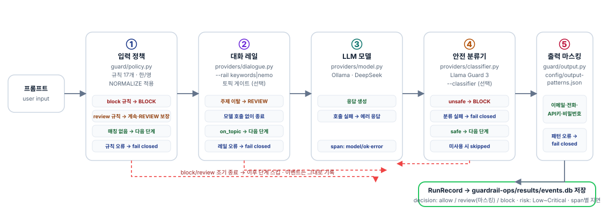
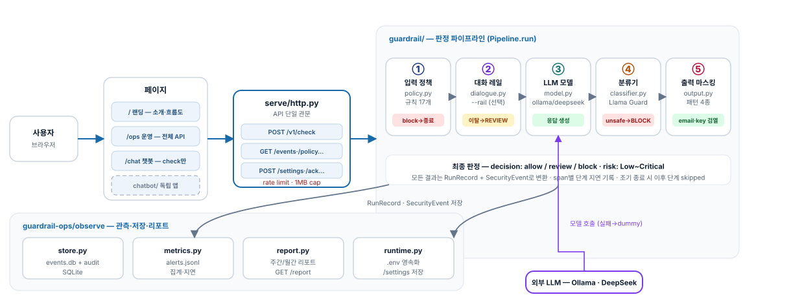
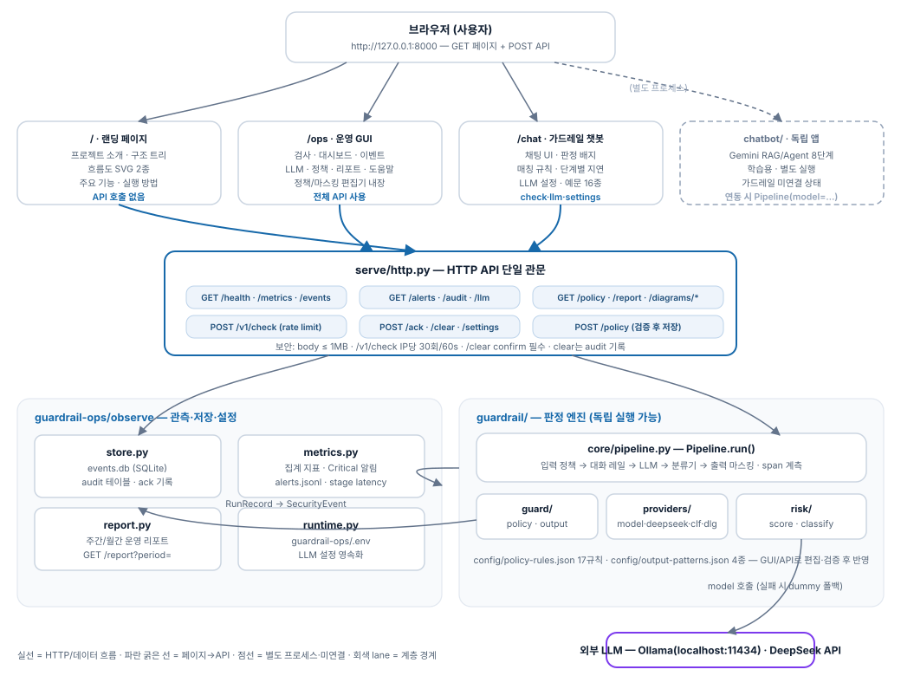

# AI Guardrail 관측(Observability) 프레임워크

01~06단계의 기능을 하나로 합친 **독립 프레임워크**다. 단계 폴더(01~06)를 import하거나 참조하지 않으며, 표준 라이브러리만으로 동작한다. 무거운 의존성(Llama Guard·NeMo Guardrails·Ollama)은 선택 사항이다.

내부 구조·정책 스키마·설계 원칙은 [docs/development.md](docs/development.md)를 참고한다.

## 동작 흐름



| 단계 | 모듈 | 역할 |
| --- | --- | --- |
| ① 입력 정책 | `guard/policy.py` | 규칙 17개(한/영) 매칭 — block 규칙은 모델 호출 없이 차단, review 규칙은 최종 REVIEW 보장 |
| ② 대화 레일 | `providers/dialogue.py` | 토픽 게이트 (`--rail`, 선택) — 주제 이탈 시 모델 호출 전 REVIEW |
| ③ LLM 모델 | `providers/model.py` | Ollama / DeepSeek / dummy (`LLM_PROVIDER`) |
| ④ 안전 분류기 | `providers/classifier.py` | Llama Guard 3 (`--classifier`, 선택) — 실패 시 fail closed |
| ⑤ 출력 마스킹 | `guard/output.py` | 이메일·전화·API 키·비밀번호 자동 검열 |

`chatbot/`의 Gemini RAG/Agent 챗봇은 이 프레임워크와 **독립**이다. 연동하려면 `Pipeline(model=...)`에 챗봇 응답 함수를 넣거나, 챗봇 측에서 `Pipeline.run()`을 호출한다.

## 서비스 흐름도





- **`/` 랜딩** — 프로젝트 소개·구조·기능만 표시, API 호출 없음
- **`/ops` 운영** — `/v1/check` 외에 정책·설정·이벤트 API를 직접 호출
- **`/chat` 챗봇** — `/v1/check`(메시지) + `/llm`(상태) + `/settings`(LLM 설정)만 사용
- 모든 쓰기 요청은 `serve/http.py` 한 곳을 통과 — rate limit·body cap·clear confirm이 여기서 강제된다

## 주요 기능

- **입력 정책** — JSON 규칙 기반 프롬프트 인젝션·시크릿 유출·위험 작업·유해 요청 차단/검토
- **출력 마스킹** — 이메일·전화번호·API 키·비밀 키워드 자동 검열
- **안전성 분류** — Llama Guard 3 (선택, `--classifier`)
- **대화 주제 레일** — NeMo Guardrails 역할의 토픽 게이트 (선택, `--rail`)
- **위험 등급** — Low~Critical 4단계, 규칙 고정값 또는 3축 점수 분류
- **관측** — trace_id·단계별 지연, SQLite 이벤트 저장, 주간/월간 리포트, Critical 알림
- **웹 GUI** — 랜딩(`/`) + 운영 페이지(`/ops`, 7개 탭) + 챗봇 페이지(`/chat`) 분리 구성

## 실행

### CLI

```bash
python 10_ai_guardrail_ops_framework/guardrail-ops/src/main.py demo
python 10_ai_guardrail_ops_framework/guardrail-ops/src/main.py run --prompt "..."
python 10_ai_guardrail_ops_framework/guardrail-ops/src/main.py metrics | events | report --period weekly
python 10_ai_guardrail_ops_framework/guardrail-ops/src/main.py ack EVENT_ID --actor 이름 --reason 사유
python 10_ai_guardrail_ops_framework/guardrail-ops/src/main.py clear
python -m unittest discover -s 10_ai_guardrail_ops_framework/tests -v
```

### HTTP 서버 + 웹 GUI

```bash
python 10_ai_guardrail_ops_framework/guardrail-ops/src/main.py serve --port 8000
# 브라우저에서 http://127.0.0.1:8000 접속
```

서버 옵션: `--host`(기본 127.0.0.1), `--port`(기본 8000), `--classifier`, `--rail keywords|nemo`.

| 메서드 | 경로 | 설명 |
| --- | --- | --- |
| GET | `/` | 가드레일 운영 GUI (검사·대시보드·이벤트·LLM·정책·리포트·도움말) |
| GET | `/chat` | 챗봇 전용 페이지 (모든 메시지가 가드레일 통과) |
| POST | `/v1/check` | `{"prompt": "..."}` → 파이프라인 실행 + 이벤트 저장 |
| GET | `/metrics` `/events` `/alerts` `/audit` | 집계·이벤트·Critical 알림·변경 감사 조회 |
| GET | `/report?period=weekly\|monthly` | 기간별 운영 리포트 |
| POST | `/ack` `/clear` | 이벤트 확인 / 전체 삭제(`{"confirm": true}` 필요) |
| GET | `/health` `/openapi.json` | 상태·API 명세 |

보호 장치: 요청 본문 1MB 제한, `/v1/check` IP당 60초 30회 rate limit.

## 모델·분류기 설정

| 환경변수/옵션 | 설명 | 기본값 |
| --- | --- | --- |
| `LLM_PROVIDER` | 모델 백엔드 선택: `ollama`(기본) / `deepseek` / `dummy` | `ollama` |
| `USE_LLM=0` | LLM 대신 더미 모델 사용 | LLM 사용 |
| `OLLAMA_BASE_URL` | Ollama 엔드포인트 | `http://localhost:11434` |
| `OLLAMA_MODEL` | 사용할 Ollama 모델 | `qwen2.5:3b` |
| `DEEPSEEK_API_KEY` | DeepSeek API 키 (provider=deepseek 시) | 없음 |
| `DEEPSEEK_MODEL` | 사용할 DeepSeek 모델 | `deepseek-chat` |
| `DEEPSEEK_BASE_URL` | DeepSeek 엔드포인트 | `https://api.deepseek.com` |
| `--classifier` | Llama Guard 3 안전성 분류 활성화 | 꺼짐 (transformers/torch 필요) |
| `LLAMA_GUARD_MODEL` | 분류기 모델 ID | `meta-llama/Llama-Guard-3-8B` |
| `--rail keywords` | 결정론적 주제 레일 | 꺼짐 |
| `GUARDRAIL_TOPICS` | 레일 주제 JSON `{"주제":["키워드"]}` | 내장 general 토픽 |
| `--rail nemo` | NeMo Guardrails 레일 | 꺼짐 (nemoguardrails 필요) |
| `GUARDRAIL_OPS_DB` / `--db` | 이벤트 DB 경로 | `results/events.db` |

이벤트 DB는 `guardrail-ops/results/events.db`, Critical 알림 로그는 `guardrail-ops/results/alerts.jsonl`에 생성된다.

## 구조

3계층으로 분리되어 있다 — `guardrail/`(판정 엔진)과 `guardrail-ops/`(관측·서빙), `chatbot/`(별도 학습용 챗봇).

```text
10_ai_guardrail_ops_framework/
├── docs/
│   └── diagrams/
├── chatbot/
├── guardrail/
│   ├── config/
│   └── src/
│       ├── core/
│       ├── guard/
│       ├── providers/
│       └── risk/
├── guardrail-ops/
│   ├── src/
│   │   ├── observe/
│   │   └── serve/
│   └── results/
└── tests/
```

주요 파일(디렉터리 아님):

- `readme.md` — 사용자 문서
- `docs/development.md` — 개발 문서·로그
- `guardrail-ops/src/main.py` — CLI 진입점
- `guardrail-ops/.env` — LLM 설정 영속화
- `guardrail/config/policy-rules.json` — 정책 규칙 17개
- `guardrail/config/output-patterns.json` — 출력 마스킹 패턴 4종
- `guardrail-ops/results/events.db` · `alerts.jsonl` — 실행 시 생성
